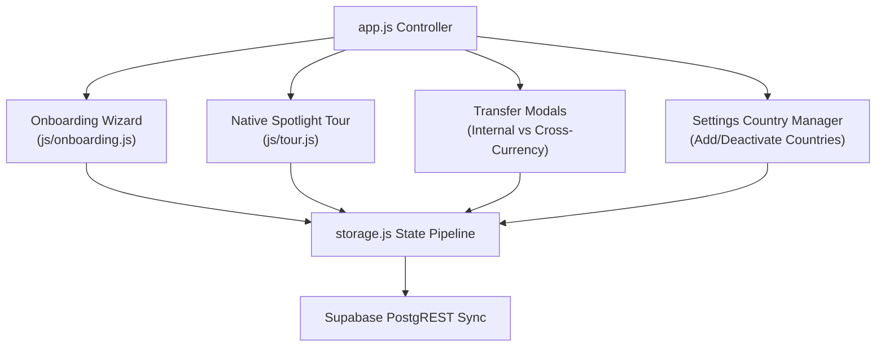

# Expense Manager — Onboarding & Architecture Assessment

**Application:** Expense Manager  
**Branch:** `test`  
**Phase:** Technical Assessment & Architectural Blueprint  
**Status:** **COMPLETED**  
**Document:** `scratch/onboarding_architecture_assessment.md`

---

## 1. Architectural Baseline & System Constraints

The application is built with vanilla JavaScript (ES6+), HTML5, CSS3, Supabase (PostgREST + Auth + Realtime), and Netlify.

### Fundamental Constraints:
1. **Zero Database Migrations Required:** The cloud Supabase database (`xrovzkibilgbpawnunle` for production, `nyetklojxqnawdtrrhma` for development) stores all application data inside the single JSON `state` column of `public.app_state(user_id, state, updated_at)`. All multi-country and onboarding capabilities are achieved by extending the client-side JSON state contract in a 100% backward-compatible manner.
2. **Fail-Closed Security Invariant:** The dual-environment whitelist in `js/supabaseClient.js` strictly rejects unknown environments or privileged service keys.
3. **Pure Two-Phase Migration Pipeline:** Any state document pulled from Supabase or loaded from local storage must pass through `previewContinuousLedgerMigration()` in `js/storage.js` to guarantee balance invariance and ID uniqueness before persistence.

---

## 2. Extended Schema v3 State Contract

To support multi-country onboarding while maintaining 100% backward compatibility with existing production records:

```typescript
interface ApplicationStateV3 {
    schemaVersion: 3;
    currentMonthKey: string;           // e.g. "2026-11"
    _updatedAt: string;                // ISO timestamp

    // --- NEW: User Preferences & Onboarding Scope ---
    preferences: {
        activeCountries: Array<'JP' | 'IN' | 'DE'>; // e.g. ['JP', 'IN'] or ['DE']
        defaultCountry: 'JP' | 'IN' | 'DE';
        onboardingCompleted: boolean;
        tourCompleted: boolean;
        theme: 'dark' | 'obsidian' | 'oled';
    };

    // --- Extended: Wallets Map (Stable ID + Display Name) ---
    wallets: {
        [walletId: string]: {
            id: string;                // Stable identifier (e.g. 'w_de_1' or legacy 'Salary Account')
            name: string;              // Editable display name
            type: 'bank' | 'cash' | 'digital' | 'card';
            region: 'JP' | 'IN' | 'DE';
            currency: '¥' | '₹' | '€';
            balance: number;           // Running balance (exact float, zero rounding)
            openingBalance?: number;   // Initial balance at setup
            color: string;             // Theme swatch
            isActive?: boolean;
        };
    };

    // --- Continuous Ledger Transactions ---
    transactions: Array<{
        id: string;                    // Timestamp-based unique ID
        date: string;                  // ISO YYYY-MM-DD
        note: string;
        type: 'expense' | 'income' | 'transfer' | 'remittance';
        amount: number;
        currency: '¥' | '₹' | '€';
        region: 'JP' | 'IN' | 'DE';
        walletId?: string;
        categoryId?: string;
        // Transfer & Cross-Currency Specific:
        sourceId?: string;
        destId?: string;
        sourceAmount?: number;
        destAmount?: number;
        sourceCurrency?: string;
        destCurrency?: string;
        exchangeRate?: string | number;
    }>;

    // --- Extended: Independent Per-Country Budgets ---
    budgets: {
        [countryCode in 'JP' | 'IN' | 'DE']?: {
            enabled: boolean;
            monthlyTotal: number;
            rolloverEnabled: boolean;
        };
    };

    // Backward-Compatibility Getters:
    // state.jpTotalBudget dynamically maps to state.budgets.JP.monthlyTotal
    // state.inTotalBudget dynamically maps to state.budgets.IN.monthlyTotal

    // --- Categories Catalog by Country ---
    categories: {
        JP: Array<{ id: string; name: string; icon: string; budget?: number }>;
        IN: Array<{ id: string; name: string; icon: string; budget?: number }>;
        DE: Array<{ id: string; name: string; icon: string; budget?: number }>;
    };

    // --- Configurable Single Loan Tracker ---
    loanConfig: {
        enabled: boolean;
        currency: '₹' | '€' | '¥';
        country: 'IN' | 'DE' | 'JP';
        totalPrincipal: number;
        principalLeft: number;
        totalDues: number;
        duesPaid: number;
        emiDrawDate: number;           // 1 to 31
        emi: number;
        annualInterestRate: number;
    };

    // --- Historical Closed Months Snapshots ---
    closedMonths: {
        [monthKey: string]: {
            monthKey: string;
            label: string;
            closedAt: string;
            walletsSnapshot: { [wId: string]: { balance: number } };
            budgetLimits?: any;
            jpTotalBudget?: number;
            jpRolloverAdded?: number;
            budgetsSnapshot?: { [countryCode: string]: { monthlyTotal: number; rolloverAdded: number } };
        };
    };

    // Backward-compatibility non-enumerable getters
    history: Array<any>;
}
```

---

## 3. Decoupling Hardcoded JP/IN Logic

Our code inspection identified 42 instances where `'JP'` and `'IN'` are hardcoded. We establish a centralized Country Registry module (`COUNTRY_CONFIG`):

```javascript
const COUNTRY_CONFIG = {
    JP: {
        code: 'JP',
        name: 'Japan',
        currency: '¥',
        currencyCode: 'JPY',
        locale: 'ja-JP',
        fractionDigits: 0,
        flagSvg: '...',
        defaultWallets: [
            { name: 'Salary Account', type: 'bank', color: '#009944' },
            { name: 'Cash', type: 'cash', color: '#d4af37' },
            { name: 'PayPay', type: 'digital', color: '#ff0033' }
        ]
    },
    IN: {
        code: 'IN',
        name: 'India',
        currency: '₹',
        currencyCode: 'INR',
        locale: 'en-IN',
        fractionDigits: 2,
        flagSvg: '...',
        defaultWallets: [
            { name: 'Bank Account', type: 'bank', color: '#97144d' },
            { name: 'Cash', type: 'cash', color: '#d4af37' }
        ]
    },
    DE: {
        code: 'DE',
        name: 'Germany',
        currency: '€',
        currencyCode: 'EUR',
        locale: 'de-DE',
        fractionDigits: 2,
        flagSvg: '...',
        defaultWallets: [
            { name: 'Checking Account', type: 'bank', color: '#1e3a8a' },
            { name: 'Cash', type: 'cash', color: '#d4af37' }
        ]
    }
};
```

### Refactoring Targets:
1. **Dynamic Active Tabs:**  
   Replace hardcoded `['JP', 'IN']` tab arrays with `storage.state.preferences.activeCountries.map(c => COUNTRY_CONFIG[c])`.
2. **Auto-Collapsing Single-Country UI:**  
   If `storage.state.preferences.activeCountries.length === 1`:
   - Hide country switcher header buttons.
   - Automatically route all transaction entries to the single active country.
   - Hide the `Cross-Currency Transfer` FAB option.
3. **Dynamic Currency Formatting:**  
   Replace `const currency = region === 'JP' ? '¥' : '₹'` with `const currency = COUNTRY_CONFIG[region]?.currency || '€'`.

---

## 4. Design System & Installed Skill Alignment

The visual design and interaction model adhere strictly to the established **Unslop** and **Emil Kowalski Motion** principles:

### A. Unslop Principles (Damir Sokolovsky — CC-BY 4.0):
- **Quiet Chrome:** Navigation, borders, backgrounds, and headers remain restrained graphite neutrals (`#0d0d11`, `#16161f`, `#20202e`, `#2d2d3f`). No glowing blobs or decorative radial gradients behind cards.
- **One Bright Element:** The physical debit card on the Wallets view and the hero expenditure chart on Dashboard carry the color. Chrome remains silent.
- **Restrained Typography:** No `font-weight: 800` or aggressive uppercase letter-spacing. Headings use 600, labels 500, body 400.
- **Tabular Lining Numbers:** Financial figures strictly utilize `font-feature-settings: "tnum"`.

### B. Emil Kowalski Motion Principles:
- **Consistent Timing & Easing:** All sheet entrances, drawer slides, and spotlight transitions strictly use:
  - `--duration-fast: 160ms`
  - `--duration-normal: 240ms`
  - `--ease-out: cubic-bezier(0.16, 1, 0.3, 1)`
- **Zero Disorienting Jumps:** The spotlight overlay animates smoothly from one interface anchor to the next using standard bounding-box interpolation.

---

## 5. Component Modularization Blueprint



1. **`js/onboarding.js`:** Encapsulated wizard controller. Renders Step 1–4 dialogs, validates inputs, and writes initial state via `storage.saveData()`.
2. **`js/tour.js`:** Zero-dependency spotlight overlay. Computes `getBoundingClientRect()` of target elements, renders mask cutout, and positions anchored tooltips.
3. **Transaction Flow Controller in `js/app.js`:**
   - Houses the distinct `Internal Transfer` and `Cross-Currency Transfer` action sheets.
   - Implements live balance impact calculation before saving.
   - Implements safe reversal with exact balance recovery.

