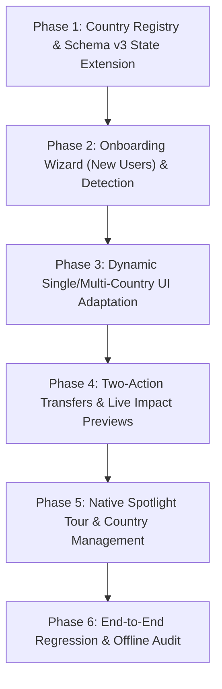

# Expense Manager — Onboarding Implementation Roadmap

**Application:** Expense Manager  
**Branch:** `test`  
**Phase:** Staged Implementation Plan  
**Status:** **APPROVED & SEQUENCED**  
**Document:** `scratch/onboarding_implementation_roadmap.md`

---

## 1. Roadmap Overview & Risk Mitigation

To ensure continuous application stability, the onboarding and multi-country evolution is broken into **six staged, risk-isolated phases**.

Each phase satisfies a strict **Verification Gate** before the next begins. Existing production data compatibility is tested at every boundary.

---

## 2. Phase-by-Phase Execution Plan

### Phase 1: Country Registry & Schema v3 State Extension
* **Goal:** Create the core data contracts without touching active UI rendering.
* **Scope:**
  - Create `js/country-config.js` defining `COUNTRY_CONFIG` for `JP`, `IN`, and `DE`.
  - Extend `defaultState` in `js/storage.js` with `preferences: { activeCountries, defaultCountry, onboardingCompleted, tourCompleted }`.
  - Add German default category catalog (`categories.DE`).
  - Add `budgets` map to `defaultState` with backward-compatible dynamic getters for `jpTotalBudget` and `inTotalBudget`.
  - Update `previewContinuousLedgerMigration()` to infer `activeCountries` automatically for existing legacy states.
* **Files Touched:** `js/country-config.js` (new), `js/storage.js`, `index.html` (script tag).
* **Verification Gate:** Run `scratch/test_compatibility_improvements.py` to confirm all 39 existing production data regression checks remain 100% passed.

---

### Phase 2: Onboarding Wizard Component (New Users)
* **Goal:** Implement the 4-step first-run setup wizard for new users.
* **Scope:**
  - Implement `js/onboarding.js` (clean class `OnboardingWizard`).
  - Add onboarding modal markup to `index.html` (hidden by default).
  - Step 1: Country selection (JP, IN, DE).
  - Step 2: Wallet setup with opening balance inputs.
  - Step 3: Optional budgeting toggle and limits per country.
  - Step 4: Optional loan tracker setup.
  - Hook into `app.init()`: If `!state.preferences?.onboardingCompleted` AND user is genuine new user (0 txs, default wallets), launch wizard.
* **Files Touched:** `js/onboarding.js` (new), `index.html`, `js/app.js`.
* **Verification Gate:** Headless test verifying new user onboarding initializes valid Schema v3 state and saves to storage. Existing user fixture does NOT trigger wizard.

---

### Phase 3: Dynamic Single/Multi-Country UI Adaptation
* **Goal:** Enable first-class single-country experience and dynamic multi-country switching.
* **Scope:**
  - Update Dashboard, Budgets, Analytics, and Reports views to read `state.preferences.activeCountries`.
  - If 1 country active: Automatically collapse country switcher pills and hide country tabs.
  - If 2+ countries active: Render clean country selector tabs styled with the Obsidian design language.
  - Update currency formatting across all views via `COUNTRY_CONFIG`.
* **Files Touched:** `js/app.js`, `js/wallet.js`, `js/charts.js`, `css/style.css`.
* **Verification Gate:** Headless visual/functional audit of Germany-only (EUR) user vs Japan+India (JPY+INR) user.

---

### Phase 4: Two-Action Transfers & Live Impact Previews
* **Goal:** Separate Internal Transfer from Cross-Currency Transfer with clear visual feedback.
* **Scope:**
  - Update Quick Action modal and FAB menu with two distinct buttons:
    1. **`Internal Transfer`**: Same currency between tracked wallets.
    2. **`Cross-Currency Transfer`**: Dynamically hidden if user only has 1 currency.
  - Implement Live Balance Impact card in transfer modals showing source deduction, destination credit, and exchange rate before saving.
  - Implement **`Reverse & Restore Balances`** in transaction detail sheet with confirmation dialog.
* **Files Touched:** `js/app.js`, `js/wallet.js`, `index.html`, `css/style.css`.
* **Verification Gate:** Headless test of transfer creation, balance shift, and reversal accuracy across same-currency and cross-currency pairs.

---

### Phase 5: Native Spotlight Tour & Country Management in Settings
* **Goal:** Deliver user education and ongoing customization.
* **Scope:**
  - Implement `js/tour.js` (vanilla SVG/canvas spotlight mask anchored to real DOM elements).
  - Add Skip button, ESC dismissal, and step indicator (`Step X of Y`).
  - Add **`Replay Guided Tour`** button in Settings.
  - Add **`Country & Currency Management`** section in Settings:
    - Add country (initializes default wallets/categories).
    - Deactivate country (hides without deleting past transactions or wallets).
* **Files Touched:** `js/tour.js` (new), `js/app.js`, `index.html`, `css/style.css`.
* **Verification Gate:** Verify tour steps adapt dynamically to single-country vs multi-country setup; verify country deactivation preserves 100% of historical transactions.

---

### Phase 6: End-to-End Regression & Verification
* **Goal:** Final hardening across all user personas.
* **Scope:**
  - Run full test matrix across single-country (DE), dual-country (JP+IN), tri-country (DE+JP+IN), and existing production export.
  - Audit Netlify build script (`scripts/build.sh`) to ensure zero secret exposure.
  - Bump Service Worker cache version in `sw.js` and query strings in `index.html`.
* **Deliverable:** Final release verification scorecard.

