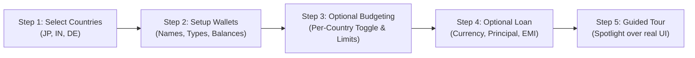

# Expense Manager — Onboarding & Multi-Country Product Specification

**Application:** Expense Manager  
**Branch:** `test`  
**Phase:** Discovery & Architectural Specification  
**Status:** **CONFIRMED & FINALIZED VIA PRODUCT DISCOVERY**  
**Document:** `scratch/onboarding_product_specification.md`

---

## 1. Executive Summary & Product Vision

Expense Manager is evolving from a fixed bilateral application (Japan JPY + India INR) into a **flexible, configurable personal finance application** supporting **Japan (JPY)**, **India (INR)**, and **Germany (EUR)**.

### Core Product Principles:
1. **First-Class Single-Country Experience:** A user living only in Germany (EUR), Japan (JPY), or India (INR) must have a clean, focused, clutter-free personal finance app. Country switchers, multi-country tabs, and cross-currency remittance buttons are completely hidden when only one country is active.
2. **First-Class Expat / Remitter Experience:** For users managing finances across two countries (e.g., Japan + India, Germany + India), the app seamlessly provides cross-currency transfers, clear exchange-rate transparency, and independent per-country budgets.
3. **Zero Financial Data Loss:** Deactivating a country, reordering wallets, or changing preferences never deletes financial transactions, historical snapshots, or wallet records.
4. **Restrained, Tactile Craft (Unslop & Emil Kowalski Motion):** No AI dashboard tropes, glowing blobs, or neon gradients. The design language preserves the established Obsidian neutral dark palette, SF Pro typography, and physical card visual craft.
5. **Seamless Continuity for Existing Users:** Current users with pre-existing data (such as our verified 116-transaction, 6-wallet production dataset) must never have their data overwritten, reset, or misclassified as empty state.

---

## 2. Supported Countries & Currency Specifications

The application initially supports three sovereign country configurations:

| Country | Code | Currency Name | Currency Symbol | Minor Units / Formatting | Standard Default Categories |
| :--- | :---: | :---: | :---: | :---: | :--- |
| **Japan** | `JP` | Japanese Yen | `¥` | Whole integer (no decimals), e.g., `¥12,500` | Food & Groceries, Dining Out, Transport, Electricity, Gas, Water, Internet, Shopping, Entertainment, Health, Personal Care, Subscriptions, Tax & Fees, Misc |
| **India** | `IN` | Indian Rupee | `₹` | 2 decimal places, Lakh/Crore system, e.g., `₹46,794.53` | Petrol, Loan EMI, Home, Rent, Medicine, Electricity (EB), Mobile Recharge, Ration, Misc |
| **Germany** | `DE` | Euro | `€` | 2 decimal places, Euro standard, e.g., `€1,245.50` | Groceries & Supermarket, Dining Out, Public Transit, Rent & Housing, Utilities (Strom/Gas), Internet & Mobile, Insurance, Health, Leisure & Subscriptions, Misc |

### Selection Rules:
- A user may select **1, 2, or all 3 countries** (typically 1 or 2).
- **Single-Country Mode:** Country switcher tabs on Dashboard, Analytics, Budgets, and Reports are automatically collapsed/hidden. The user sees only their currency.
- **Multi-Country Mode:** Clean tabbed pills (e.g. `[Japan (¥)]` `[Germany (€)]`) allow switching context on Dashboard, Budgets, and Reports.

---

## 3. Onboarding Experience (First-Time Users)

New users (empty database row or 0 transactions) are welcomed with a focused, 5-step modal wizard:



### Step 1: Country Selection
- Clean cards for Japan (JPY `¥`), India (INR `₹`), Germany (EUR `€`).
- Multi-select checkboxes with visual card highlight.
- Validation: At least one country must be selected to proceed.

### Step 2: Wallet Setup
- Pre-populated starter suggestions based on selected countries:
  - **Germany:** Checking Account (Bank), Cash.
  - **Japan:** Salary Account (Bank), Cash, PayPay (Digital).
  - **India:** Bank Account, Cash.
- User can add custom wallets, choose wallet type (`bank`, `cash`, `digital`, `card`), choose a color swatch, and enter an optional **Opening Balance**.
- **Accounting Invariant:** Opening balance is saved directly to `wallet.balance` (with `wallet.openingBalance` preserved as reference). It does **not** create synthetic income transactions, preventing distortion of monthly income analytics.

### Step 3: Optional Budgeting Setup
- Independent toggle per selected country: `"Enable Monthly Budgeting for [Country]?"`
- If enabled:
  - Input overall monthly budget (e.g., `50,000 ¥` for JP, `1,200 €` for DE).
  - Opt-in toggle: `"Enable monthly savings rollover into budget cushion"` (defaults to enabled for JP, opt-in for others).
  - Optional category spending limits.
- If disabled: Country functions purely as an expense/income tracker without progress bars or budget warnings.

### Step 4: Optional Loan Tracking Setup
- Simple prompt: `"Do you have an active loan (e.g. personal loan, auto loan, mortgage) to track?"`
- If No: `loanConfig.enabled = false`. Loan tracker widget is completely hidden.
- If Yes:
  - Select loan currency from active countries.
  - Enter: Total Principal, Principal Remaining, Total EMIs, EMIs Paid, Monthly EMI Amount, and Monthly Draw Date (Day 1–31).
  - Home view renders the existing progress widget.

### Step 5: Guided Tour Launch
- Immediate transition to the Native Spotlight Guided Tour.

---

## 4. Existing User Migration & Continuity

Existing production users have valuable historical records (e.g., our verified 116-transaction dataset across 6 wallets).

### Existing User Invariant Rules:
1. **Never Re-Initialize State:** If `state.wallets` has user entries or `state.transactions.length > 0`, the onboarding setup wizard is **bypassed entirely**.
2. **Automatic Scope Inference:**
   - Active countries are automatically derived from existing wallet regions (e.g. presence of `Salary Account` (JP) and `Axis Bank` (IN) sets `activeCountries = ['JP', 'IN']`).
   - Existing Japan budget (`jpTotalBudget: 50000`) and rollover records are automatically preserved.
   - Existing India loan (`loanConfig` with 7 dues paid) remains active and untouched.
3. **Tour on First Update with Prominent Skip:**
   - Existing users receive the Native Spotlight Guided Tour on their first login after the update to introduce the new multi-country settings and transfer capabilities.
   - Includes an unmistakable **"Skip Tour"** button and keyboard `ESC` dismissal.
   - A permanent **"Replay Guided Tour"** option is added to Settings -> Preferences.

---

## 5. Wallet Architecture & Stable Identifiers

### Wallet Data Contract:
```typescript
interface Wallet {
    id: string;               // Stable, immutable identifier (e.g. 'w_de_checking_1793710' or legacy 'Salary Account')
    name: string;             // User-editable display label (e.g. 'N26 Checking' or 'Main Salary')
    type: 'bank' | 'cash' | 'digital' | 'card';
    region: 'JP' | 'IN' | 'DE';
    currency: '¥' | '₹' | '€';
    balance: number;          // Current running balance (exact float, zero rounding)
    openingBalance?: number;  // Reference opening balance entered at creation
    color: string;            // Hex color code (e.g. '#009944')
    isActive?: boolean;       // Allows archiving without deletion
}
```

### Renaming & Stability Rules:
- Every wallet maintains a **permanent `id`**.
- Editing a wallet's display `name` does **not** change its `id`.
- Historical transactions reference `walletId: wallet.id`. Therefore, **renaming a wallet never mutates past transactions** or alters continuous ledger history.
- Existing legacy wallets keep their existing string key (e.g. `'Salary Account'`) as their stable `id` for 100% backward compatibility.

---

## 6. Transfers & Cross-Currency Mechanics

Users without financial terminology knowledge must be able to move money between wallets safely.

### The Two Explicit Actions:
The Floating Action Menu (FAB) and Quick Action modal provide two distinct buttons:
1. **`Internal Transfer` (Same Currency):**
   - Available to all users.
   - For moving money between wallets of the **same currency** (e.g. Bank Account → Cash).
   - Fields: `Source Wallet`, `Destination Wallet`, `Amount`, `Note`.
   - Simple validation: Source amount = Destination amount.
2. **`Cross-Currency Transfer` (Different Currencies):**
   - **Dynamically hidden** if the user only has one active currency.
   - For moving money between tracked wallets in different currencies (e.g. JPY → INR, EUR → INR, EUR → JPY).
   - Fields:
     - `From Wallet` (Currency A) → `Amount Sent`
     - `To Wallet` (Currency B) → `Amount Received`
     - `Exchange Rate`: Auto-calculated as `Amount Received / Amount Sent` (or manually entered).
     - Clear fee/spread disclosure text.

### Live Balance Impact Preview:
Inside the transfer modals, before saving, a dynamic preview card displays:
```text
Live Balance Impact:
• Salary Account: 31,907 ¥  ──( -40,000 ¥ )──►  -8,093 ¥
• Axis Bank:      46,794 ₹  ──( +23,794 ₹ )──►  70,588 ₹
Exchange Rate: 1 JPY = 0.5948 INR
```

### Safe Reversal & Correction:
When viewing any transfer or cross-currency transfer in the Transaction Detail sheet:
- A dedicated **"Reverse & Restore Balances"** button is available.
- Reversal calculates the exact inverse: credits the source wallet and debits the destination wallet.
- Confirmation dialog explicitly summarizes the reversal before executing:
  `"Reversing this transfer will restore 40,000 ¥ to Salary Account and deduct 23,794 ₹ from Axis Bank. Proceed?"`

---

## 7. Budgeting & Rollover Rules

### Independent Per-Country Budgeting:
- Budgeting is strictly partitioned by country code (`JP`, `DE`, `IN`).
- **No Cross-Currency Budget Aggregation:** Germany has its own EUR budget, Japan has its own JPY budget. The app never attempts to add EUR to JPY using volatile live rates for daily spending targets.
- Single-country users see a single consolidated budget bar.
- Dual-country users toggle between country tabs on the Budgets page.

### Rollover Calculation:
- Rollover operates independently per country:
  $$\text{RolloverAdded}_{\text{country}} = \sum_{\text{cat} \in \text{Categories}_{\text{country}}} \max(0, \text{Budget}_{\text{cat}} - \text{Spent}_{\text{cat}})$$
- Unspent category savings pool into that country's total monthly budget cushion.
- Rollover is an opt-in toggle per country.

---

## 8. User Education & Native Spotlight Guided Tour

### Guided Tour Architecture:
- **Zero Third-Party Dependencies:** Implemented in pure vanilla JS/CSS.
- **Spotlight Mask:** A dark backdrop overlay (`rgba(0, 0, 0, 0.75)`) with an SVG cutout or border-box shadow spotlight highlighting real interface elements.
- **Anchored Cards:** Floating obsidian card anchored adjacent to the target element with a caret pointing to it.
- **Adaptive Step Sequence:**
  1. *Welcome:* Overview of personal finance workspace.
  2. *Country Scope:* Country pills (if multi-country).
  3. *Wallets Card:* Physical debit card view & balance summary.
  4. *Add Transaction:* FAB menu (Internal Transfer vs Cross-Currency Transfer).
  5. *Budgets:* Budget progress and category limits (skipped if budgeting disabled).
  6. *Reports & Statements:* PDF exports and historical audit.
  7. *Settings & Customization:* Where to add/remove countries, customize wallets, and replay the tour.
- **Controls:** `Step X of Y`, `Next`, `Back`, `Skip Tour`, keyboard `ESC` dismissal.

---

## 9. Country Management in Settings (Post-Onboarding)

Under Settings -> **Country & Currency Management**:
- **Add a Country:**
  - One-click addition of Germany, Japan, or India.
  - Automatically initializes recommended default categories and starter wallets.
- **Deactivate a Country:**
  - Hides the country from active dashboard tabs, quick transaction selectors, and bottom navigation.
  - **Zero Data Loss Guarantee:** Never deletes past transactions, closed monthly ledgers, or wallets. Historical records remain fully searchable and filterable in the global ledger.
  - Can be re-enabled at any time with complete state restoration.

