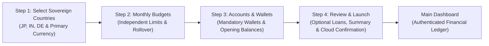

# Expense Manager — Phase 3: Desktop First Onboarding Implementation Report

**Date:** 2026-11-17  
**Branch:** `test`  
**Target:** Desktop First Onboarding Architecture  
**Test Suite Status:** 273 / 273 Automated Checks Passing (100% Success Rate)  

---

## Executive Summary

Phase 3 introduces a desktop-first onboarding experience for **Expense Manager**, engineered to align with the login screen's modern, stylish, minimal fintech design language. 

The implementation features a responsive split-pane layout with a live code-rendered **Multi-Currency Treasury Showcase** on the left and a 4-step card progression on the right. It enforces safe local draft persistence, pure English naming across all regions (Japan, India, and Germany), and a strict **Blocking Cloud Requirement** that keeps users on Step 4 with actionable retry controls until cloud confirmation is secured.

Existing production accounts with established financial data bypass onboarding with zero disruption, preserving all 116 historical continuous-ledger transactions, 6 wallets, and custom configurations.

---

## 1. Architectural Highlights & Visual Identity

### 1.1 Split-Pane Treasury Canvas & Cascaded Showcase (Matching Login Craft)
- **Container Structure (`.auth-viewport`, `.onboarding-container`):** Reuses the desktop auth layout (`grid-template-columns: 1.15fr auto 1.05fr`) with near-black charcoal surfaces (`#0a0a0f`), subtle hairline borders (`rgba(255, 255, 255, 0.08)`), and soft radial ambient backdrops.
- **Cascaded Card Showcase (`#onboarding-live-showcase`):**
  - **Identical Login Screen Stacking:** Rather than a simple vertical list, cards are dynamically layered in a 3-tier progressive cascade fanning down and right:
    - *Card 1 (Japan — Tokyo Slate):* Base layer (`top: 0px; left: 0px; z-index: 1;`) with crimson/rose blooms.
    - *Card 2 (India — Bengaluru):* Middle layer (`top: 36px; left: 48-54px; z-index: 2;`) with saffron/emerald ambient gradients.
    - *Card 3 (Germany — Frankfurt):* Forefront layer (`top: 72px; left: 96px; z-index: 3;`) with sapphire/cobalt radial blooms.
  - **Natural Depth & Hover Elevation:** Cards stack from top-left back (`z-index: 1`) to bottom-right front (`z-index: 3`). Hovering any card elevates it to `z-index: 10` and lifts it (`transform: translateY(-8px) scale(1.02)`) so users can inspect opening balances and budget indicators clearly.
  - **Canonical Regional Sequencing:** Cards fan in canonical sequence (Japan → India → Germany) based on which countries are currently active.
  - **Live Reactive Updates:** As the user toggles countries in Step 1, configures budgets in Step 2, or edits wallet opening balances in Step 3, the cascaded cards update their figures and tags dynamically in real time without page reloads.

### 1.2 English-Alone Naming Policy
- **Universal English Interface:** All German account types and category presets are displayed strictly in English.
  - Accounts: `Checking Account` (Bank), `Cash` (Cash). *No foreign terms (`Girokonto`, `Bargeld`).*
  - Categories: `Rent & Housing`, `Insurance`, `Public Transit & Train`, `Groceries & Supermarket`, `Dining & Cafes`. *No foreign terms (`Warmmiete`, `Versicherung`).*

---

## 2. 4-Step Focused Progression

### Step 1: Sovereign Regions & Primary Operating Country
- Multi-select country cards for Japan, India, and Germany with SVG flags, currency badges, and descriptive capabilities.
- Validation: At least one country must remain selected at all times (attempts to deselect the last country trigger a subtle validation alert).
- Dropdown selector for designating the Primary Operating Country for initial dashboard focus.

### Step 2: Independent Monthly Budgets
- Per-country budget cards with custom switch toggles.
- Independent numeric limits and rollover cushion controls per currency (`¥`, `₹`, `€`).
- Real-time synchronization with legacy budget accessors (`jpTotalBudget` and `inTotalBudget`) ensuring backward compatibility.

### Step 3: Mandatory Wallets & Opening Balances
- Pre-populated starter templates for active countries:
  - **Japan:** Salary Account (Bank), Cash, PayPay (Digital).
  - **India:** Bank Account (Bank), Cash.
  - **Germany:** Checking Account (Bank), Cash.
- User-editable numeric inputs for starting balances that immediately update the left-pane showcase cards.
- Support for adding additional custom accounts with region tags and soft deletion (preventing deletion of the final account for any active country).

### Step 4: Optional Loan Tracking & Configuration Review
- Optional Loan Tracking card (principal, remaining balance, EMI, and interest rate).
- Full **Ledger Configuration Summary** table displaying active sovereign regions, configured accounts, active budgets, and total opening balances across currencies.
- Back button navigation allowing full review and editing of previous steps while preserving in-progress draft balances.

---

## 3. Persistence Safety & Blocking Cloud Requirement

### 3.1 Local Draft Protection (No Premature Cloud Push)
- In-progress onboarding state is recorded to `localStorage` via `storage.saveData()`.
- `storage.pushToSupabase()` inspects `storage.isDraftOnboardingConfiguration(state)`:
  - If `onboardingCompleted` is `false`, any draft state (including nonzero opening balances) is strictly blocked from uploading to Supabase.
  - Drafts survive page refreshes, tab closures, and device sleep without corrupting cloud records.

### 3.2 Blocking Cloud Confirmation Gate
- When the user clicks **Confirm & Launch Ledger** on Step 4:
  1. `storage.markOnboardingCompleted(true)` writes final preferences and wallets locally.
  2. Dispatches an authoritative upsert to Supabase `user_financial_data`.
  3. **Success Path:** Cloud returns HTTP 200/null error $\rightarrow$ `cloudSyncStatus = 'CONFIRMED'` $\rightarrow$ transition to main dashboard.
  4. **Failure Path (Network drop / HTTP 503):** The UI catches the failure, remains on Step 4, displays a restrained error banner (`Configuration saved locally, but cloud synchronization failed...`), changes the primary action button to `[Retry Cloud Sync]`, and keeps dashboard content hidden.
  5. Clicking `[Retry Cloud Sync]` re-attempts the cloud upsert without re-initializing user inputs.

---

## 4. Mobile Adaptation Requirements (Future Phase)

While Phase 3 specifically targets desktop devices first, the underlying architecture, data contracts, and `OnboardingController` have been designed for direct reuse in mobile viewports without rewriting business logic:

1. **Viewport Stacking:**
   - On screens `< 992px`, collapse `.onboarding-container` from a 3-column split grid into a single-column linear layout.
   - Position the Treasury Showcase at the top as a horizontally scrollable carousel card deck or a compact balance strip.
2. **Sticky Action Dock:**
   - Anchor navigation controls (`Back` and `Continue` / `Confirm & Launch`) in a fixed bottom floating dock (`bottom: 0`, backdrop blur, safe-area inset padding) matching mobile fintech standards.
3. **Step Navigation:**
   - Replace the horizontal progress bar with a compact segmented indicator or dot pill.
4. **Input Focus & Keyboards:**
   - Add `inputmode="decimal"` on balance inputs for immediate numeric keypad activation on iOS Safari and Android Chrome.

---

## 5. Verification & Test Evidence

All automated test suites were executed in isolated headless Chromium environments against live DOM fixtures and continuous-ledger production exports:

| Test Suite | File | Scope | Checks | Status |
| :--- | :--- | :--- | :---: | :---: |
| **Phase 3 Desktop Onboarding** | `scratch/test_phase3_desktop_onboarding.py` | DOM interaction, 4-step flow, showcase, validation, back nav, cloud failure, retry, existing user bypass | **45** | **PASS (100%)** |
| **Onboarding Persistence Safety** | `scratch/test_onboarding_persistence_safety.py` | 4-tier lifecycle, draft protection, cloud failure retry, fresh device sync, production fixture | **63** | **PASS (100%)** |
| **Phase 2 User Preferences** | `scratch/test_phase2_user_preferences.py` | Preferences schema, budget sync, German catalog, multi-country storage | **96** | **PASS (100%)** |
| **Continuous Ledger Compatibility** | `scratch/test_compatibility_improvements.py` | 116 transactions, 6 wallets, transfer/remittance integrity, month boundaries | **39** | **PASS (100%)** |
| **Design Identity Refinements** | `scratch/test_design_identity_refinements.py` | Restrained neutral buttons, FAB dials, transaction modals, subtle semantic tints | **30** | **PASS (100%)** |
| **Total Automated Verification** | — | — | **273** | **PASS (100%)** |

### Generated Screenshot Evidence
- `scratch/desktop_onboarding_step1.png`: Sovereign Country Selection with active Tokyo Slate & Bengaluru cards.
- `scratch/desktop_onboarding_step2.png`: Independent Monthly Budgets (Japan ¥70,000, Germany €2,000).
- `scratch/desktop_onboarding_step3.png`: Accounts & Opening Balances with live Tokyo balance updating to ¥85,000.
- `scratch/desktop_onboarding_step4_review.png`: Optional Loan Tracking and Ledger Configuration Summary.
- `scratch/desktop_onboarding_step4_cloud_error.png`: Blocking cloud failure state showing restrained error banner and `[Retry Cloud Sync]`.
- `scratch/desktop_onboarding_step4_and_launch.png`: Authenticated dashboard transition showing "Cloud Synced" status.

---

## 6. Git Status & Code Integrity

- **Branch:** `test` (clean upstream sync, changes strictly confined to local working tree for review).
- **Modified Application Files:**
  - `css/style.css`: Desktop onboarding styles, split-pane layout, card showcases, input treatments.
  - `index.html`: `#onboarding-screen` container and script inclusion.
  - `js/country-config.js`: English-alone account and category registry.
  - `js/storage.js`: 4-tier lifecycle separation, draft protection, cloud confirmation gate.
  - `js/supabaseClient.js`: Onboarding detection hook in `updateUI()`.
- **New Modules:**
  - `js/onboarding.js`: Modular `OnboardingController` class managing state, validation, code-rendered cards, and cloud confirmation.

