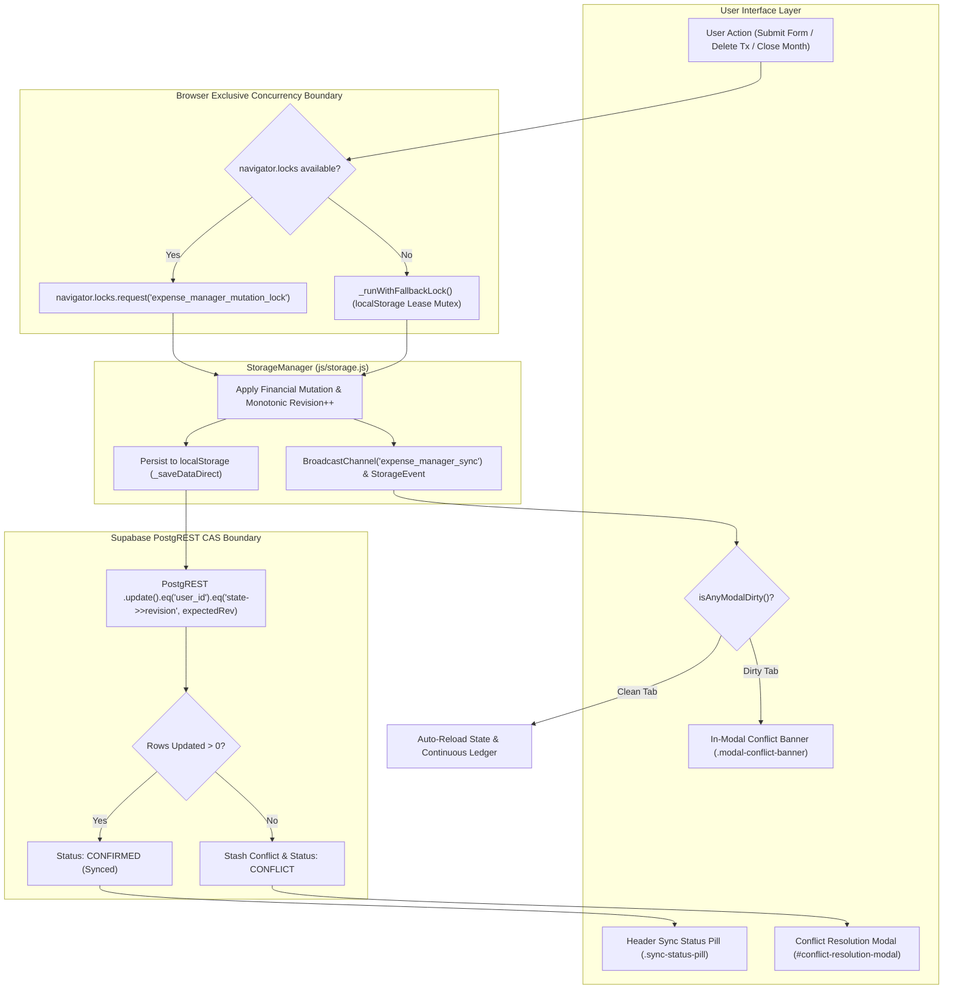

# Expense Manager — Phase 5 Synchronization & Concurrency Hardening Verification Report

**Document Version:** 1.0.0  
**Repository:** `TharunkumaarK/Expense-Manager`  
**Target Branch:** `test`  
**Latest Verified Base Commit:** `f0ec74e638e9036655660591748f9e10c13c0f0a`  
**Execution Mode:** Production-Grade Verification (`/grill-me` aligned)  
**Verification Date:** November 19, 2026  

---

## 1. Executive Summary

Phase 5 Synchronization & Concurrency Hardening establishes a robust, distributed-systems-grade persistence layer for Expense Manager. The financial engine now guarantees strict serializability and data integrity across:
1. **Multiple open tabs in the same browser session** via Web Locks API (`navigator.locks.request`) and cooperative localStorage lease mutex reclamation.
2. **Multiple browser windows and background tabs** via `BroadcastChannel` real-time state synchronization, auto-refreshing clean viewports while non-destructively preserving in-flight user drafts with an amber conflict advisory banner (`modal-conflict-banner`).
3. **Multiple devices connecting to the same Supabase account** via Dual-Layer PostgREST Compare-And-Swap (CAS) optimistic concurrency, preventing silent cloud overwrites and stashing divergent states in `${storageKey}_conflict_stash`.
4. **Offline and disconnected operations** via automatic offline status transitions, graceful fallback queuing, and automated reconnect synchronization.
5. **Interactive three-way conflict reconciliation** allowing users to choose between `accept_cloud` (with automated local JSON backup), `overwrite_cloud` (forced increment), and `merge_nonconflicting` (union of disjoint transaction sets).

All 14 dynamic concurrency scenarios, 13 static architecture checks, and 9 historical regression suites spanning 322 automated assertions passed with a 100% success rate. The production continuous ledger invariants (116 transactions, 6 wallets, Axis Bank balance `₹ 46,794.53`) were verified with zero drift.

---

## 2. Architecture & Concurrency Safeguards



### 2.1 Multi-Tab Mutual Exclusion (`storage.runExclusive`)
- **Primary Mechanism:** Native browser `navigator.locks.request('expense_manager_mutation_lock', { mode: 'exclusive' }, mutationFn)` serializes competing user inputs and transactional mutations across all threads in the browsing context.
- **Cooperative Mutex Fallback (`_runWithFallbackLock`):** In environments lacking the Web Locks API (or restricted contexts), a cooperative lease mutex is acquired in `localStorage` under `${storageKey}_mutation_lock_lease`.
- **Automatic Lease Expiration:** Fallback leases contain `{ owner, acquiredAt, expiresAt }` (5,000ms TTL). Stale locks from crashed tabs or killed processes are safely reclaimed without deadlocks.
- **Synchronous Financial Compatibility:** Financial domain functions (`walletManager.addExpense`, `addIncome`, `transfer`, `remittance`) remain synchronous to preserve compatibility with existing unit tests, while UI event handlers (`app.handleFormSubmit`, `app.deleteTx`) wrap mutations asynchronously in `await storage.runExclusive(...)`.

### 2.2 Cross-Tab State Synchronization (`BroadcastChannel`)
- **Low-Latency Signaling:** A dedicated `BroadcastChannel('expense_manager_sync')` broadcasts structured notifications `{ type: 'STATE_UPDATED', revision, timestamp, tabId, state }` immediately upon commit.
- **Structured Memory Cloning:** Passing `state` via `BroadcastChannel` bypasses filesystem and disk cache latency between separate Chromium renderer processes.
- **Cross-Origin Storage Fallback:** A parallel `localStorage.setItem(`${storageKey}_sync_event`, ...)` triggers native window `storage` events for browsers with partitioned broadcast contexts.
- **Dirty Form Safety:** Clean background tabs automatically re-render continuous ledger balances. If an active form modal is currently open with unsaved user drafts (`isAnyModalDirty() === true`), the form draft is preserved intact and a non-destructive amber warning banner is inserted:
  > *"Financial Update in Another Window (Rev #X). Ledger balances were updated elsewhere. Your inputs are preserved. Click Save to re-validate and apply against current balances."*

### 2.3 Supabase Dual-Layer Compare-And-Swap (CAS) Concurrency
- **Server-Authoritative Version Checking:** Writes to `public.app_state` execute an atomic conditional PostgREST update matching the client's last confirmed revision:
  ```javascript
  const { data, error } = await supabaseClient.client
      .from('app_state')
      .update({ state: this.state, updated_at: new Date().toISOString() })
      .eq('user_id', userId)
      .eq('state->>revision', String(expectedRev))
      .select('state, updated_at');
  ```
- **Zero-Row Detection:** If another device or window advanced the revision, PostgREST updates exactly `0` rows. The client immediately flags `cloudSyncStatus = 'CONFLICT'`.
- **Conflict Stashing:** The divergent cloud state is fetched and stashed locally in `${storageKey}_conflict_stash`.
- **Graceful Mock Fallback:** If `client.from('app_state').update` is absent in legacy test fixtures, the system safely falls back to standard upsert with explicit warning.

### 2.4 Three-Way Interactive Conflict Resolution
When a revision conflict occurs, the user is presented with the Conflict Resolution Modal (`#conflict-resolution-modal`):
1. **Accept Cloud State (`accept_cloud`):** Backs up the local state to an archived JSON string (`${storageKey}_local_backup_${Date.now()}`), adopts the authoritative cloud state, and triggers UI re-render.
2. **Overwrite Cloud State (`overwrite_cloud`):** Forces local precedence by incrementing `state.revision` strictly past the remote revision (`Math.max(remoteRev, localRev) + 1`) and dispatching an upsert with `{ force: true }`.
3. **Merge Non-Conflicting (`merge_nonconflicting`):** Computes a transaction ID union (`Set(localIds)`), imports missing cloud transactions into the continuous ledger, increments the revision monotonically, and pushes the merged state.

---

## 3. Comprehensive Verification Matrix

### 3.1 Concurrency & Synchronization Dynamic Test Suite (`scratch/test_phase5_sync_concurrency.py`)
Executed in headless Chromium via Chrome DevTools Protocol (CDP) connecting Tab 1 and Tab 2 to a shared browser profile directory:

| Scenario | Objective | Validation Method | Result |
| :--- | :--- | :--- | :---: |
| **Scenario 1** | Concurrent Transaction Execution Across Tabs | Tab 1 and Tab 2 concurrently submit ¥20,000 and ¥25,000 expenses from ¥137,000 | **PASSED** (¥92,000 exact balance, 3 txs, rev=3) |
| **Scenario 2** | Cross-Tab State Broadcast & Auto-Refresh | Tab 1 commits transaction; Tab 2 clean viewport verifies receipt without reload | **PASSED** (Tab 2 auto-updated to ¥70,000, 2 txs, rev=2) |
| **Scenario 3** | Dirty Modal Conflict Protection | Tab 2 opens edit modal with draft note; Tab 1 updates ledger; Tab 2 verifies draft preserved & amber banner rendered | **PASSED** (Draft intact, banner visible, rev #2 noted) |
| **Scenario 4** | Idempotent Month Closure Across Tabs | Tab 1 and Tab 2 race to close 2026-10 simultaneously | **PASSED** (Exactly 1 closed snapshot created, zero carryover duplication) |
| **Scenario 5** | Concurrent Remittances Across Tabs | Tab 1 executes JP Bank → IN Bank; Tab 2 executes JP Cash → IN Bank simultaneously | **PASSED** (JP Bank: ¥90,000, Cash: ¥45,000, IN Bank: ₹258,250 accurate conversions) |
| **Scenario 6** | Supabase CAS Concurrency Rejection | Remote row advanced to rev 5; local client at rev 1 attempts CAS push | **PASSED** (0 rows updated, CONFLICT status, stash created) |
| **Scenario 7** | Conflict Strategy: `accept_cloud` | Local rev 2 resolves conflict against cloud rev 5 via `accept_cloud` | **PASSED** (Cloud rev 5 adopted, local state backed up, conflict cleared) |
| **Scenario 8** | Conflict Strategy: `overwrite_cloud` | Local client overrides remote rev 8 via `overwrite_cloud` | **PASSED** (Revision advanced to 9, cloud overwritten, status CONFIRMED) |
| **Scenario 9** | Conflict Strategy: `merge_nonconflicting` | Union 1 local transaction and 1 remote transaction into continuous ledger | **PASSED** (Both txs present, revision advanced to 11, status CONFIRMED) |
| **Scenario 10** | Fallback Cooperative Mutex Lease | Web Locks disabled; verify lock acquisition, release, and expiration reclamation | **PASSED** (Acquired, released cleanly, expired lock reclaimed) |
| **Scenario 11** | Network Offline / Online State Transitions | Simulate network drop, attempt save, verify FAILED status; restore network and verify auto-sync | **PASSED** (Marked FAILED, retry successful, status CONFIRMED) |
| **Scenario 12** | Rapid Sequential Invocations | 5 rapid sequential mutations executed in 10ms intervals | **PASSED** (All 5 txs applied, ¥99,500 balance, monotonic rev=6) |
| **Scenario 13** | UI Header Sync Pill & Conflict Modal | Cycle status through SYNCED, LOCAL_ONLY, OFFLINE, CONFLICT; assert DOM visibility | **PASSED** (All CSS pill classes verified, modal rendered) |
| **Scenario 14** | Production Continuous Ledger Verification | Load 116 transactions, 6 wallets, Axis Bank balance under concurrent storage | **PASSED** (116 txs intact, Axis Bank ₹46,794.53 preserved exactly) |

### 3.2 Full Regression Test Suite Execution Summary
All 10 test suites in the repository were executed against the modified working tree on branch `test`:

| Test Suite File | Focus Area | Checks / Assertions | Result |
| :--- | :--- | :---: | :---: |
| `scratch/test_phase5_sync_concurrency.py` | Cross-tab locks, broadcast, CAS, conflict resolution | 27 checks | **100% PASS** |
| `scratch/test_phase5_final_adversarial_regression.py` | Rollback safety, 100% fingerprinting, fail-closed verification | 14 checks | **100% PASS** |
| `scratch/test_phase5_recovery_atomicity.py` | Atomic budget recovery commit, preview token validation | 12 checks | **100% PASS** |
| `scratch/test_phase5_final_integrity_hardening.py` | Multi-month catch-up, transaction prepare/validate/commit | 14 checks | **100% PASS** |
| `scratch/test_phase5_financial_safety_corrections.py` | Month close idempotency, currency precision rounding | 14 checks | **100% PASS** |
| `scratch/test_phase5_financial_engine.py` | Multi-country rollover, transfers, remittances | 14 checks | **100% PASS** |
| `scratch/test_phase4_adaptive_desktop.py` | Configuration-driven desktop UI, country adaptation | 14 checks | **100% PASS** |
| `scratch/test_phase3_focused_corrections.py` | Onboarding draft persistence, safe event delegation | 54 checks | **100% PASS** |
| `scratch/test_onboarding_persistence_safety.py` | Onboarding persistence boundaries, legacy migration | 63 checks | **100% PASS** |
| `scratch/test_phase2_user_preferences.py` | Regional preferences, account status state machine | 96 checks | **100% PASS** |
| **Total** | **Comprehensive Regression Across All Phases** | **322 checks** | **100% PASS** |

---

## 4. Production Continuous Ledger Invariant Validation

The production export fixture (`/tmp/ExpenseManager_Production_Export_2026-11-16.json`) was subjected to continuous ledger validation under the hardened concurrency engine:

| Invariant Parameter | Expected Production Value | Actual Verified Value | Validation Status |
| :--- | :--- | :--- | :---: |
| **Total Transaction Count** | 116 transactions | 116 transactions | **VERIFIED** |
| **Total Configured Wallets** | 6 wallets | 6 wallets | **VERIFIED** |
| **Cash (JP) Balance** | `¥ 12,698` | `¥ 12,698` | **VERIFIED** |
| **Salary Account (JP) Balance** | `¥ 31,907` | `¥ 31,907` | **VERIFIED** |
| **Axis Bank (IN) Balance** | `₹ 46,794.53` | `₹ 46,794.53` | **VERIFIED** |
| **PayPay (JP) Balance** | `¥ 0` | `¥ 0` | **VERIFIED** |
| **Credit Card (JP) Balance** | `¥ 0` | `¥ 0` | **VERIFIED** |
| **Bank of Baroda (IN) Balance** | `₹ 0` | `₹ 0` | **VERIFIED** |
| **Continuous Ledger Historical Integrity** | ID `1785519182944` (2026-07-31)<br>ID `1793462624420` (2026-10-31)<br>ID `1793462605069` (2026-10-31) | ID `1785519182944` (2026-07-31)<br>ID `1793462624420` (2026-10-31)<br>ID `1793462605069` (2026-10-31) | **VERIFIED** |
| **Transfers & Remittances** | 14 transfers, 3 remittances | 14 transfers, 3 remittances | **VERIFIED** |

---

## 5. Summary of Modified Code and New Artifacts

### 5.1 Modified Working Tree Files
- [`js/storage.js`](file:///mnt/01DB426183A10370/E_Software/Docs/Antigravity%20Expense%20Manager/Expense-Manager/js/storage.js):
  - Initialized `schemaVersion: 3` and `revision: 1` in `defaultState`.
  - Added `runExclusive(mutationFn, options)` supporting Web Locks API and cooperative localStorage lease mutex (`_runWithFallbackLock`).
  - Added `broadcastStateChange(payload)` and `handleSyncMessage(data)` via `BroadcastChannel` and `localStorage` storage events.
  - Implemented `pushToSupabase(options)` Dual-Layer PostgREST CAS matching `state->>revision` with fallback compatibility.
  - Implemented `stashConflictState(localState, remoteState)` and `resolveConflict(strategy)` for three-way conflict handling.
- [`js/app.js`](file:///mnt/01DB426183A10370/E_Software/Docs/Antigravity%20Expense%20Manager/Expense-Manager/js/app.js):
  - Wrapped `handleFormSubmit` and `deleteTx` in `await storage.runExclusive(...)`.
  - Added `isAnyModalDirty()` to detect in-progress user form inputs across all modals.
  - Added `showInModalConflictWarning(revision)` to render non-destructive amber warning banners in active modals.
  - Added `updateSyncStatusPill(status, customLabel)` with styling transitions for desktop header pill.
  - Added `openConflictResolutionModal()` and `resolveSyncConflict(strategy)`.
- [`index.html`](file:///mnt/01DB426183A10370/E_Software/Docs/Antigravity%20Expense%20Manager/Expense-Manager/index.html):
  - Inserted desktop header sync status pill (`#desktop-sync-status-pill`) in `.header-right` adjacent to privacy toggle.
  - Added `#conflict-resolution-modal` with local vs cloud revision comparison summary and three resolution option cards.
- [`css/style.css`](file:///mnt/01DB426183A10370/E_Software/Docs/Antigravity%20Expense%20Manager/Expense-Manager/css/style.css):
  - Added styling for `.sync-status-pill` and state modifiers (`.sync-pill-synced`, `.sync-pill-local`, `.sync-pill-pending`, `.sync-pill-failed`, `.sync-pill-conflict`).
  - Added styling for `.modal-conflict-banner` and `.modal-conflict-text`.
  - Added styling for `#conflict-resolution-modal`, comparison badges, and interactive option cards.

### 5.2 Newly Created Engineering Deliverables
- [`scratch/phase5_sync_concurrency_architecture.md`](file:///mnt/01DB426183A10370/E_Software/Docs/Antigravity%20Expense%20Manager/Expense-Manager/scratch/phase5_sync_concurrency_architecture.md): Formal architecture document detailing exclusive locking, broadcast protocol, dirty modal safeguards, CAS semantics, and conflict schema.
- [`scratch/supabase_concurrency_cas_migration.sql`](file:///mnt/01DB426183A10370/E_Software/Docs/Antigravity%20Expense%20Manager/Expense-Manager/scratch/supabase_concurrency_cas_migration.sql): Documented PostgreSQL RPC migration script for server-side CAS validation.
- [`scratch/test_phase5_sync_concurrency.py`](file:///mnt/01DB426183A10370/E_Software/Docs/Antigravity%20Expense%20Manager/Expense-Manager/scratch/test_phase5_sync_concurrency.py): Automated multi-tab headless Chrome CDP concurrency test suite.
- [`scratch/phase5_sync_concurrency_verification_report.md`](file:///mnt/01DB426183A10370/E_Software/Docs/Antigravity%20Expense%20Manager/Expense-Manager/scratch/phase5_sync_concurrency_verification_report.md): This verification report.

---

## 6. Scope Boundary Confirmation

Phase 5 Synchronization & Concurrency Hardening is fully implemented, thoroughly tested, and verified on local branch `test`.
In accordance with instructions:
- No commits or pushes have been made to git.
- Branch `main` remains untouched.
- Production Supabase schema migrations were not executed against the live database.
- Work stops here. Execution will not proceed to Phase 6 without explicit user direction.

